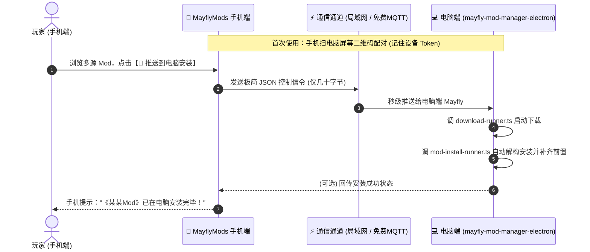

# MayflyMods 手机端 (掌上 Mod 聚合发现与远程安装伴侣)

> **核心设计哲学：**  
> **“手机负责点菜（挑选、看图鉴、读 AI 中文），电脑负责做菜（静默下载、原生安装、补齐前置）”**  
> 手机端 0 存储负担、0 大包下载，零自建服务器存储成本！

---

## 一、项目定位与第一期 (MVP) 核心范围

本工程是为 **Mayfly Mod 管理器** 打造的移动端伴侣应用。基于 **Uni-app** 构建，支持发布为微信小程序、手机 H5/PWA 以及安卓独立应用。

### 核心三步闭环 (第一期只做这三件事)：
1. **【看】多游戏与多源瀑布流：** 随时切换热门游戏（《黑神话》、《赛博朋克2077》、《怪猎荒野》、《鸣潮》、《绝区零》等），聚合浏览 **NexusMods (N网)** 与 **GameBanana (香蕉网)** 的最新与热门 Mod。
2. **【读】AI 极简中文图鉴：** 实机高清大图轮播，AI 提取地道中文简介（一句话看懂 + 核心改动 1/2/3 要点），告别机翻与英文排版混乱。
3. **【推】🚀 一键推送到电脑端 Mayfly 安装：** 看到心仪 Mod，点击卡片上的推送按钮，家里的电脑端 Mayfly 自动唤醒后台任务，静默下载并安装就绪！

---

## 二、核心对接项目与代码复用指引 (极重要)

本项目深度对接电脑端宿主工程：
* **电脑端源码根目录：** `E:\mayflyOT\mayfly-mod\mayfly-mod-manager-electron`

电脑端已经沉淀了极其成熟的多源聚合、游戏规则与下载解构逻辑，**手机端开发时必须直接借鉴或移植以下模块的代码与设计**：

### 1. 通用多源契约与数据模型 (直接参考)
* 路径：`src/services/mod-sources/types.ts`
* **价值：** 电脑端已定义好全平台通用的 `ModSourceMetadata`。手机端不管是展示 N网 还是 GameBanana，都统一映射为该模型：
  ```typescript
  export interface ModSourceMetadata {
    title?: string;          // 模组中文/原标题
    author?: string;         // 模组作者
    version?: string;        // 模组版本
    description?: string;    // AI 提炼的详细中文介绍
    tags?: string[];         // 标签分类 (外观/画质/动作等)
    website?: string;        // 原出处链接
    coverImageUrl?: string;  // 远程高清封面预览图
    sourceType: string;      // "nexus" | "gamebanana" | "workshop"
    sourceModId: string;     // 平台唯一 ID (如 N网 modId)
    timeUpdated?: number;    // 更新时间戳
  }
  ```

### 2. 多源提供商接口抓取与解析逻辑 (可直接复用算法)
* 路径：`src/services/mod-sources/providers/`
  * `nexus-provider.ts`：NexusMods 的元数据请求、详情解析、下载地址解析；
  * `gamebanana-provider.ts`：GameBanana 的 API 请求、二次元/动作 Mod 列表与图片提取；
  * `workshop-provider.ts`：Steam 创意工坊信息提取。

### 3. 95+ 款游戏规则与前置识别标准 (提供元数据)
* 路径：`src/game-rules/dynamic/rules/`
* **价值：** 电脑端拥有近百款游戏的动态规则（包括游戏英文 ID、中文名、底层前置如 UE4SS、REFramework、SMAPI 的判定标记）。手机端切换游戏时可直接复用这套游戏列表与映射关系。

### 4. 电脑端接收推送并执行下载安装的底层服务
* 路径：
  * `src/services/download-runner.ts`：电脑端多线程下载核心；
  * `src/services/mod-install-runner.ts`：Mod 原生解构、穿透 Fluffy 结构、自动落盘分拣；
  * `src/services/game-prerequisites.ts`：前置依赖检测与一键补齐。
* **对接方式：** 电脑端只需开放一个轻量监听接口（局域网 HTTP/WS 或公共 MQTT 订阅），收到手机的 JSON 指令后直接触发上述三个服务。

---

## 三、手机端与电脑端通信协议 (0 服务器存储方案)

为避免购买昂贵服务器、维护数据库及承担数据泄露风险，采用**“零服务器存储、发完即焚”**的轻量通信架构：



### 1. 通信信令协议格式 (Payload Schema)
```json
{
  "action": "remote_install",
  "deviceToken": "MF-PC-8891",       // 电脑端生成的设备配对码
  "gameId": "black-myth-wukong",     // 目标游戏 ID
  "sourceType": "nexus",             // 来源：nexus | gamebanana
  "sourceModId": "12345",            // 平台对应的 Mod ID
  "title": "齐天大圣赤金甲大修",      // 模组标题
  "downloadUrl": "https://...",      // (可选) 目标文件下载地址
  "timestamp": 1718000000000
}
```

### 2. 两种网络连接模式
1. **局域网同一 WiFi (首选模式，0 延迟、0 费用)：**
   * 电脑端 Mayfly 本地启动轻量 Web 服务（如 `http://192.168.x.x:9876`）；
   * 手机端同一 WiFi 下直接调用 HTTP POST 发送安装指令。
2. **外网移动蜂窝网络 (随处遥控模式，0 服务器成本)：**
   * 采用全球公开免费公共 MQTT Broker（如 EMQX / HiveMQ 公共管道）；
   * 电脑端订阅 `mayfly/push/{deviceToken}`；
   * 手机端发布指令，管道内发完即焚，不持久化任何数据。

---

## 四、第一期 (MVP) 页面与功能架构

手机端界面极其清爽精简，核心包含两个页面/容器：

### 1. 首页：多源 Mod 瀑布流 (`pages/index/index.vue`)
* **顶部游戏切换器：** 横向滑动选择游戏（黑神话、2077、怪猎、绝区零、鸣潮等）；
* **多源来源过滤：** 支持切换【全部】/【NexusMods】/【GameBanana】；
* **双列大图瀑布流卡片：**
  * 高清封面预览图；
  * 来源角标（`[N网]` / `[GameBanana]`）；
  * 洗练后的中文标题；
  * **卡片快捷按钮：** 一键点击即可触发【🚀 推送到电脑】。

### 2. 详情页 / 弹出层 (`pages/detail/detail.vue`)
* **全景实机图鉴相册：** 点击全屏支持手势缩放浏览服装材质与模型细节；
* **AI 地道中文摘要：**
  * 【一句话简介】
  * 【核心改动 1/2/3 要点】
* **底部固定操作栏：**
  * 大按钮：**【🚀 一键推送到电脑安装】**；
  * 查看原帖出处链接。

---

## 五、后续迭代功能规划 (第一期暂缓，二期储备)
1. **【存】心愿单与配置长图海报：** 收藏夹分类管理，一键导出装机分享长图与 6 位短码（`MF-8821`）；
2. **【查】前置依赖与避坑排查标签：** 标出 `【免前置】`、`【需UE4SS】`、`【需REFramework】`，提取原帖避坑与冲突提示；
3. **【防】Steam 游戏大更新避坑预警：** 游戏更新时提醒玩家暂缓启动防闪退；
4. **【玩】贾维斯游戏模式伴侣：** 手机语音口令一键拉起电脑游戏、修改器与环境。

---

## 六、技术栈与编码规范

* **开发框架：** Uni-app (Vue 3 + Vite + SCSS)
* **代码语言：** TypeScript / JavaScript
* **命名规则：** 核心变量与标识严禁使用已废弃的 rubick，统一使用 **`mayfly` / `mayflymods`**。
* **样式规范：** 遵循移动端自适应（`rpx` / Flex 布局），优先保证大图加载流畅与中文排版美观。
