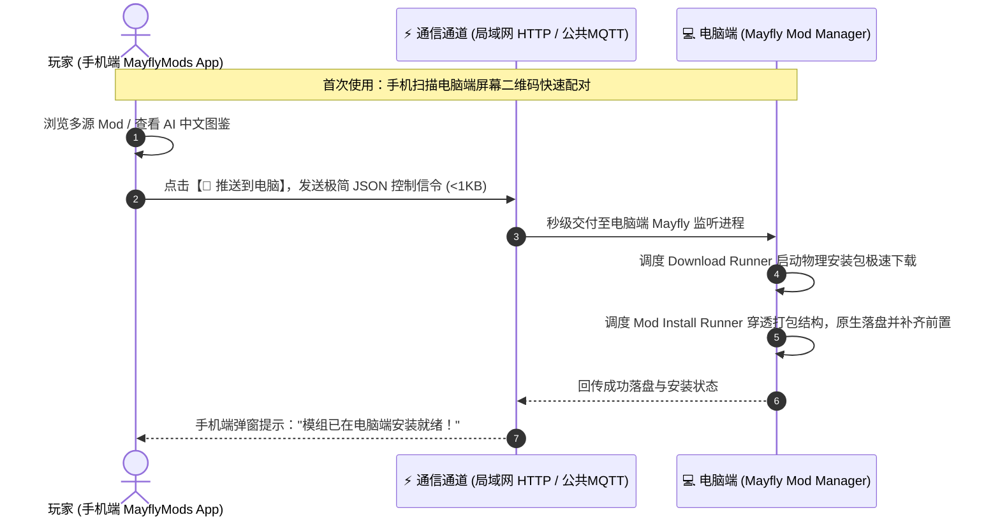

<p align="center">
  
</p>

<h1 align="center">MayflyMods App</h1>

<p align="center">
  <strong>新一代游戏模组掌上发现伴侣 & 远程无感装机中枢</strong><br>
  Next-Generation Mobile Companion for Game Mod Discovery & Remote PC Installation
</p>

<p align="center">
  <a href="https://uniapp.dcloud.net.cn/"></a>
  <a href="https://vuejs.org/"></a>
  <a href="https://vitejs.dev/"></a>
  <a href="https://nexusmods.com/"></a>
  <a href="LICENSE"></a>
  <a href="https://github.com/"></a>
</p>

---

## 📖 项目简介 (Introduction)

**MayflyMods App** 是专为 **Mayfly Mod 管理器** 打造的高颜值、高性能移动端伴侣应用。基于 Uni-app 构建，全面支持多端编译（H5/Web、手机 PWA、安卓独立 App 及微信小程序）。

> 💡 **核心设计哲学：**  
> **“手机负责点菜（随时挑选、看图鉴、读 AI 中文、存心愿单），电脑负责做菜（静默下载、原生解构、自动补齐前置）”**  
> 手机端 0 存储负担、0 大包耗流，不设中心化存储服务器，实现极致纯粹的玩家体验！

---

## ✨ 核心特性 (Key Features)

### 1. 🎨 100% 对标 NexusMods 官方暗黑移动端视觉
- **沉浸式暗黑美学**：经典 Nexus 橙标配色与极简高对比卡片布局。
- **全网模组 / 游戏专区双视角**：
  - **模组流视角**：双列 16:9 高清海报卡片、实时动态分类胶囊、New / Updated / Trending / Popular 热门多维排序；
  - **游戏海报视角**：双列竖版 2:3 官方精美海报封面、原汁原味统计指标（模组数、关注数、下载量）。

### 2. 🌐 AI 智能双语图鉴 (告别机翻乱码)
- **毫秒级中文图鉴**：动态将游戏名称、官方分类标签、模组标题与简介自动转译为地道中文。
- **原生 BBCode 富文本转译**：完整保留原作者富文本排版（白字加粗、暖金链接、代码块、引用框），阅读体验清爽舒适。
- **双语一键切换**：支持随心切换“智能中文图鉴”与“英文原版”。

### 3. 🚀 远程一键推送到电脑（0 服务器存储方案）
- 看到心仪 Mod，点击卡片右上角或详情底部的 **【🚀 推送到电脑】**，电脑端 Mayfly 自动唤醒后台任务，静默下载并部署！
- **双通道自适应通信**：
  - 🏠 **局域网同一 WiFi（首选）**：基于 LAN HTTP 信令直接投递，0 延迟、安全且不耗公网流量；
  - 🌐 **外网移动蜂窝网络**：基于全球免认证 MQTT 公共管道，即发即焚，零隐私泄露风险。

### 4. 🔐 NexusMods 官方账户授权系统
- **三种登录模式**：
  - ⚡ **官方免密 SSO 网页授权**：通过官方 WebSocket 长连接信道，一键跳转网页授权并支持 2FA 验证码输入，自动回传激活；
  - 🔑 **Personal API Key 直连**：官方直连校验，提供官方获取链接一键复制助手；
  - 💻 **从电脑端 Mayfly 一键同步**：手机与电脑配对后，直接拉取电脑已登录凭证，免除重复输入。
- **特权信息展示**：支持识别 Premium 尊贵会员、Supporter 支持者徽标与专属特权加速说明。

### 5. 🧩 彻底的组件化与多页面解耦架构
- **6 大独立路由页面**（在 `pages.json` 拥有独立生命周期与状态）：
  - `pages/index/index`：模组流与全网热门主页；
  - `pages/games/games`：热门游戏独立双列海报墙与搜索；
  - `pages/favorites/favorites`：装机心愿单独立管理与批量投递；
  - `pages/history/history`：推送任务历史清单与单项重推；
  - `pages/profile/profile`：个人中心、授权状态与偏好设置；
  - `pages/detail/detail`：全景模组图鉴（Hero 大图、5 列指标、截图画廊、双列元数据表格、物理分流文件清单）。
- **通用复用组件**：
  - `<NexusHeader>`：沉浸式全局顶栏（抽屉/返回、Logo、搜索、分享、电脑端指示灯、用户头像）；
  - `<NexusDrawer>`：全局侧边抽屉导航（用户信息、当前游戏卡片、全局路由项、电脑连接状态）；
  - `<NexusTabBar>`：全局底部标签栏（跨页面快捷路由调度）；
  - `<ModCard>`：标准模组海报卡片；
  - `<NexusAuthModal>`：Nexus 官方三合一授权中心；
  - `<DevicePairModal>`：局域网扫码与手动配对弹窗；
  - `<PushHistoryModal>`：快速推送历史抽屉；
  - `<UpgradeModal>`：版本检测与热更新升级弹窗。

### 6. ❤️ 装机心愿单与游戏专属隔离
- 支持“当前激活游戏”与“全网游戏”心愿单过滤切换，杜绝跨游戏收藏混淆。
- 支持一键导出专属装机分享口令，方便社区互抄作业；支持心愿单模组批量一键投递至电脑端自动排队装机。

---

## 🔄 远程装机协同流程 (Architecture Flow)



---

## 📁 目录结构 (Directory Structure)

```text
mayflymods-app/
├── components/                 # 全局高复用组件库
│   ├── DevicePairModal.vue     # 电脑端配对与扫码连接弹窗
│   ├── ModCard.vue             # 标准双列海报模组卡片
│   ├── NexusAuthModal.vue      # Nexus 官方三合一登录授权弹窗
│   ├── NexusDrawer.vue         # 侧边沉浸式导航抽屉
│   ├── NexusHeader.vue         # 全局标准沉浸式暗黑顶栏
│   ├── NexusTabBar.vue         # 底部沉浸式标签导航栏
│   ├── NexusIcon.vue           # 矢量图标集合组件
│   ├── NexusModal.vue          # 通用暗黑对话框基础组件
│   ├── NexusSelect.vue         # 下拉选项选择器组件
│   ├── PushHistoryModal.vue    # 快速推送历史查看抽屉
│   └── UpgradeModal.vue        # 版本升级与更新弹窗
├── pages/                      # 独立业务页面
│   ├── index/index.vue         # 主页：精选模组瀑布流与游戏快速入口
│   ├── games/games.vue         # 独立页面：热门游戏海报图鉴专区
│   ├── favorites/favorites.vue # 独立页面：装机心愿单与批量导出/推送
│   ├── history/history.vue     # 独立页面：推送任务清单与单项重推
│   ├── profile/profile.vue     # 独立页面：个人中心、授权状态与偏好设置
│   └── detail/detail.vue       # 独立页面：模组全景图鉴与分流文件清单
├── services/                   # 底层通信与业务逻辑
│   ├── favorites.js            # 心愿单本地加密存储与同步
│   ├── games.js                # 本地与远程游戏专区字典
│   ├── history.js              # 推送任务历史记录与状态中枢
│   ├── nexus.js                # Nexus 官方公开 GraphQL 直连与账号服务
│   ├── poster.js               # 分享海报生成与装机口令解析
│   ├── remote-channel.js       # 局域网 HTTP + 公共 MQTT 双通道自适应中枢
│   ├── translate.js            # 智能中文图鉴与分类映射转译引擎
│   └── upgrade.js              # 客户端升级与版本管理服务
├── static/                     # 静态资源与应用图标
├── scripts/
│   └── build.cjs               # 极速构建与 SFC 模板闭环完整性校验脚本
├── App.vue                     # 应用入口生命周期
├── main.js                     # Vue 应用实例化
├── pages.json                  # 全局多页面路由与窗口样式配置
├── manifest.json               # Uni-App 应用跨端编译清单
└── package.json
```

---

## 🚀 快速上手 (Quick Start)

### 1. 环境准备
确保本机已安装 [Node.js](https://nodejs.org/) (建议 Node 18+)。

```bash
# 克隆代码仓库
git clone https://github.com/your-username/mayflymods-app.git

# 进入项目目录
cd mayflymods-app

# 安装依赖
npm install
```

### 2. 本地开发与调试
```bash
# 启动本地开发服务 (支持 H5 实时热重载)
npm run dev

# 或在 HBuilderX 中直接点击【运行】->【运行到内置浏览器 / Chrome】
```

### 3. 项目构建与静态验证
本项目配备了自动化静态规范检查脚本，确保所有页面标签闭合完整、路由配置合规：

```bash
# 执行完整构建检查
npm run build
```

---

## 💻 电脑端配对指南 (Desktop Pairing)

手机端与电脑端 Mayfly 互联极其简单：

1. 打开电脑端 **Mayfly Mod 管理器**；
2. 进入 **【设置】 -> 【移动端互联】**，获取当前电脑局域网 IP 与连接二维码；
3. 打开手机端 **MayflyMods App**，点击顶栏电脑图标 💻 打开配对弹窗；
4. 点击 **【📷 扫描屏幕二维码】**（或手动输入电脑 IP 地址），点击 **【测试连接】**，提示“已连接”即完成配对！

---

## 🤝 贡献与反馈 (Contributing)

我们非常欢迎社区开发者提交 Issue 或 Pull Request！
- 提交 Bug 或功能建议：请前往 [GitHub Issues](https://github.com/your-username/mayflymods-app/issues)
- 遵循统一代码规范与组件化拆分原则，提交前请确保运行并通过 `npm run build`。

---

## 📜 开源协议 (License)

本项目采用 [MIT License](LICENSE) 开源协议。

### 免责声明 (Disclaimer)
* 本应用为开源辅助工具，所有模组资产、图片及描述信息均来源于 **NexusMods** 等官方平台；
* 本项目严格遵循 NexusMods 开发者 API 使用协议，不存储、不侵权、不分流原作者的物理资产文件；
* 所有模组所有权与知识产权均归原作者所有。
